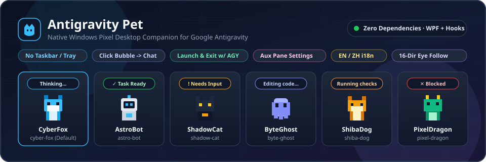
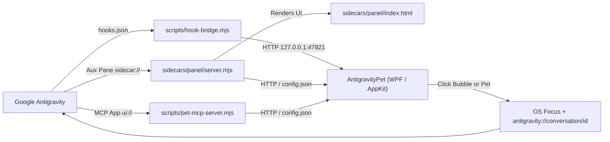

<div align="center">



# 🐾 Antigravity Pet

**A native Windows & macOS pixel desktop companion plugin for Google Antigravity — zero third-party runtime dependencies.**

[](https://github.com/Wlaeg/antigravity-pet)
[](app)
[](pets)
[](#english)
[](LICENSE)

[English](#english) · [简体中文](#简体中文)

</div>

---

<a id="english"></a>

## English

**Antigravity Pet** brings a lightweight, reactive pixel-art companion directly to your Windows & macOS desktop while you work with **Google Antigravity**. Powered by a native transparent overlay (**C# WPF** on Windows / **Swift AppKit** on macOS), Antigravity lifecycle hooks, and an integrated Aux Pane Settings Panel (`...` menu & MCP App), it works out of the box with zero external SDKs or runtimes.

### ✨ Highlights

- **Zero Taskbar, Tray & Dock Clutter**
  - Uses Win32 `WS_EX_TOOLWINDOW` on Windows and `LSUIElement` / `NSApplication.ActivationPolicy.accessory` on macOS so the floating pet never occupies a taskbar button, tray icon, or Dock icon.
  - Global show/hide toggle hotkey: **`Win + Alt + P`** (Windows) / **`⌥ + ⌘ + P`** (macOS).
- **Click Bubble or Pet to Jump Straight to Chat**
  - Whether a task is **running** or **ready**, clicking the status bubble or the pet itself brings Antigravity to the foreground (even if minimized or hidden) and opens that exact conversation via `antigravity://conversation/<id>`.
- **Launch & Exit with Antigravity**
  - No OS login/startup clutter. When **Launch with Antigravity** is enabled, the pet starts automatically alongside Antigravity and exits gracefully shortly after Antigravity closes.
- **Built-in Settings Panel (`...` Menu & MCP App)**
  - Manage everything inside Antigravity's top-right `...` plugin menu (**Desktop Pet Settings**): enable/hide/quit pet, switch characters, adjust scale (`0.75x / 1.0x / 1.3x / 1.5x`), bubble mode (`always / alerts / off`), **bubble style (`Simple` vs `Detailed Stacked` with hover-to-expand `Task - State` cards & `📌 Pin`)**, launch with Antigravity, idle roaming, 16-direction eye tracking, always-on-top, sound alerts, and quick links to recent conversations.
- **EN / ZH Bilingual UI (Auto-Follows Antigravity)**
  - Automatically detects your Antigravity locale or lets you switch instantly between **Auto (Follow Antigravity)**, **English**, and **简体中文**.
- **Crisp `36×39` Pixel-Art Engine**
  - Nearest-neighbor scaled `8×11` sprite atlas (`1536×2288 px`, `192×208 px` per frame) supporting idle breathing, walking, waving, jumping, working, waiting alerts, failure states, celebration loops, and 16-direction cursor eye-tracking.

---

### 🎭 Built-in Pixel Characters

| ID | Display Name | Style & Personality | Pack Location |
| :--- | :--- | :--- | :--- |
| `cyber-fox` | **CyberFox** *(Default)* | Neon cyan cyber fox with glowing accents | [`pets/cyber-fox`](pets/cyber-fox) |
| `astro-bot` | **AstroBot** | Mini space explorer with animated visor | [`pets/astro-bot`](pets/astro-bot) |
| `shadow-cat` | **ShadowCat** | Nimble dark cat with bright golden eyes | [`pets/shadow-cat`](pets/shadow-cat) |
| `byte-ghost` | **ByteGhost** | Playful floating pixel spirit | [`pets/byte-ghost`](pets/byte-ghost) |
| `shiba-dog` | **ShibaDog** | Warm golden Shiba Inu companion | [`pets/shiba-dog`](pets/shiba-dog) |
| `pixel-dragon` | **PixelDragon** | Emerald mini dragon with golden horns | [`pets/pixel-dragon`](pets/pixel-dragon) |
| `android-bugdroid` | **Android Bugdroid** | Classic Google Android green robot mascot | [`pets/android-bugdroid`](pets/android-bugdroid) |
| `flutter-dash` | **Flutter Dash** | Official Google Flutter & Dart blue bird mascot | [`pets/flutter-dash`](pets/flutter-dash) |

> Custom pet packs placed inside `%USERPROFILE%\.antigravity-pet\pets\<pet-id>\` or `pets\<pet-id>\` are loaded automatically and can be hot-reloaded without restarting.

---

### 🔔 Multi-Session Priority & Status Machine

When multiple Antigravity conversations run concurrently, the pet arbitrates display state strictly by priority:

| Priority | State | Trigger (`hooks.json`) | Visual & Bubble Feedback |
| :---: | :--- | :--- | :--- |
| **1** | `Needs Input` | User confirmation / question required | Amber halo + `!` badge + prompt bubble + optional chime |
| **2** | `Blocked` | Tool error or execution failure | Red halo + `✕` badge + error bubble (click to inspect) |
| **3** | `Ready` | Agent task finishes (`Stop`) | Green celebration loop + `✓` badge + clickable completion bubble |
| **4** | `Running` | Thinking, file edits, commands (`PreInvocation` / `PostToolUse`) | Cyan halo + busy working animation + live step bubble |
| **5** | `Idle` | No active tasks | Gentle breathing + idle desktop roaming + 16-dir eye follow |

---

### 🧩 Architecture & Project Structure



```text
antigravity-pet/
├── app/
│   ├── AntigravityPet.cs            # Windows native WPF overlay, HTTP server & hotkey
│   ├── AntigravityPet.exe           # Prebuilt zero-dependency Windows executable
│   └── AntigravityPet.swift         # macOS native AppKit overlay, HTTP server & hotkey
├── assets/
│   ├── logo.svg                     # Plugin icon
│   └── preview.svg                  # Repository showcase banner
├── pets/                            # 6 built-in 8x11 pixel-art sprite packs
├── scripts/
│   ├── generate-default-pets.ps1    # Procedural 36x39 pixel-art spritesheet generator
│   ├── hook-bridge.mjs              # Cross-platform Antigravity hooks -> HTTP bridge
│   └── pet-mcp-server.mjs           # Cross-platform MCP server + MCP App UI provider
├── sidecars/panel/
│   ├── sidecar.json                 # Aux Pane integration manifest (... menu)
│   ├── server.mjs                   # Cross-platform Sidecar backend & auto-launcher
│   └── index.html                   # Bilingual settings panel UI
├── skills/
│   ├── pet/SKILL.md                 # Skill guide for controlling the desktop pet
│   └── hatch-pet/SKILL.md           # Skill guide for generating custom pixel pets
├── ui/settings.html                 # MCP App standalone settings UI
├── build.ps1                        # Windows one-click builder & launcher
├── build.sh                         # macOS one-click Swift compiler & .app packager
├── hooks.json                       # Antigravity hook bindings
├── mcp_config.json                  # MCP server configuration
├── plugin.json                      # Antigravity plugin manifest
└── README.md
```

---

### 🚀 Installation & Quick Start

#### Windows 10 / 11

1. Clone or copy this repository into your Antigravity plugins directory:
   ```text
   %USERPROFILE%\.gemini\config\plugins\antigravity-pet\
   ```
2. Run the one-click build & launch script (uses built-in `.NET Framework 4.x` `csc.exe`, **no extra SDK required**):
   ```powershell
   cd "$env:USERPROFILE\.gemini\config\plugins\antigravity-pet"
   .\build.ps1 -Launch
   ```
3. Reload or open **Google Antigravity**, then click **`...`** at the top-right to open **Desktop Pet Settings** (or press **`Win + Alt + P`** anytime to toggle visibility).

#### macOS 12+ (Apple Silicon & Intel)

1. Clone or copy this repository into your Antigravity plugins directory:
   ```text
   ~/.gemini/config/plugins/antigravity-pet/
   ```
2. Run the one-click Swift build & launch script (uses macOS built-in `swiftc`, **no extra SDK required**):
   ```bash
   cd ~/.gemini/config/plugins/antigravity-pet
   chmod +x build.sh && ./build.sh --launch
   ```
   *(If Xcode Command Line Tools are not installed yet, run `xcode-select --install` first. Antigravity hooks will also auto-compile on first start.)*
3. Open **Google Antigravity**, click **`...`** at the top-right for **Desktop Pet Settings**, or press **`⌥ + ⌘ + P`** (`Option + Command + P`) anytime to show/hide.

---

### 🎨 Custom Pet Spritesheet Specification (`v2`, `8×11` Grid)

Each custom pet pack only requires two files: `pet.json` and `spritesheet.png` (32-bit RGBA transparent PNG, `1536×2288 px`, each cell `192×208 px`):

```json
{
  "id": "my-pet",
  "displayName": "MyPet",
  "description": "Custom pixel companion",
  "spriteVersionNumber": 2,
  "spritesheetPath": "spritesheet.png"
}
```

| Row | Animation State | Recommended Frames | Notes |
| :---: | :--- | :---: | :--- |
| `0` | `idle` | 6 | Gentle idle breathing & blinking |
| `1` | `running-right` | 8 | Walking right during desktop roaming |
| `2` | `running-left` | 8 | Walking left during desktop roaming |
| `3` | `waving` | 4 | Friendly wave (triggered on cursor greeting) |
| `4` | `jumping` | 5 | Joyful jump animation |
| `5` | `failed` | 8 | Error / blocked state (`Blocked`) |
| `6` | `waiting` | 6 | Waiting for confirmation (`Needs Input`) |
| `7` | `running` | 6 | Busy working animation (`Running`) |
| `8` | `review` | 6 | Task completion celebration (`Ready`) |
| `9–10` | `look-directions` | 16 (8 + 8) | Clockwise gaze directions (0 = Right, 4 = Down, 8 = Left, 12 = Up) |

---

### 🌐 Local HTTP Control API (`http://127.0.0.1:47821`)

| Endpoint | Method | Description | Example Payload |
| :--- | :---: | :--- | :--- |
| `/health` | `GET` | Returns running status, i18n language, full config, stats, recent chats, and pet list | — |
| `/state` | `POST` | Updates conversation state (`idle` / `running` / `needs_input` / `ready` / `blocked`) | `{"conversationId":"abc","state":"running","message":"Thinking..."}` |
| `/skin` | `POST` | Switches the active character pack | `{"skin":"cyber-fox"}` |
| `/reload` | `POST` | Hot-reloads pet packs from `pets/` and `%USERPROFILE%\.antigravity-pet\pets\` | `{}` |
| `/control` | `POST` | Executes window & config actions (`show`/`hide`/`toggle`/`open`/`quit`/`language`/`scale`/`bubbleMode`/`updateConfig`) | `{"action":"language","value":"en"}` |

---

<a id="简体中文"></a>

## 简体中文

**Antigravity Pet** 是专为 **Google Antigravity** 打造的原生跨平台（**Windows & macOS**）像素风桌面宠物插件。Windows 端基于原生 C# WPF 透明悬浮窗（`WS_EX_TOOLWINDOW`），macOS 端基于原生 Swift AppKit 悬浮窗（`LSUIElement`），结合 Antigravity 生命周期 Hooks 与客户端右上角 `...` 内置设置面板，**零第三方运行时依赖，开箱即用**。

### ✨ 核心亮点

- **零任务栏、系统托盘与 Dock 干扰**
  - Windows 采用 `WS_EX_TOOLWINDOW` 扩展样式，macOS 采用 `LSUIElement` + `.accessory` 策略，绝不在任务栏、系统托盘或 macOS Dock 栏占用图标。
  - 全局显隐热键：**`Win + Alt + P`**（Windows）/ **`⌥ + ⌘ + P`**（macOS），随时一键召唤或隐藏。
- **点击气泡或本体，直达对应对话**
  - 无论任务正在**运行中**还是**已完成**，点击头顶气泡或桌宠本体，即使 Antigravity 处于最小化或隐藏状态，也能自动唤醒窗口并通过 `antigravity://conversation/<id>` 精确跳转至对应会话。
- **随 Antigravity 启动与退出**
  - 不写入开机自启项、不占开机资源；开启 **「随 Antigravity 启动」** 后，打开 Antigravity 时自动拉起桌宠，关闭客户端时自动退出并保留配置。
- **客户端内全量设置面板（右上角 `...` 插件目录）**
  - 直接在 Antigravity 右上角三个点（`...`）选择 **「桌面宠物设置」**，即可手动开启/隐藏/退出桌宠、切换 8 款像素角色、调整窗口尺寸（`0.75x / 1.0x / 1.3x / 1.5x`）、配置气泡显示模式与 **气泡展示风格（简易模式 / 详细堆叠展开模式：显示「任务名称 - 状态」，悬停展开全部并发会话并支持 `📌` 固定跟踪）**、开启待机散步、16 方向眼神跟随鼠标、置顶、提示音，以及查看最近对话并一键跳转。
- **内置中英文双语切换（自动跟随 Antigravity 语言）**
  - 支持 **跟随 Antigravity (自动)**、**English** 与 **简体中文** 实时切换，气泡提示与设置面板同步更新。
- **精致 `36×39` 像素动画引擎**
  - 采用最近邻（Nearest-Neighbor）无模糊缩放渲染 `8×11` 精灵图集（`1536×2288`，单格 `192×208`），包含待机呼吸、左右散步、挥手打招呼、开心跳跃、忙碌工作、等待输入、出错晕眩、完成庆祝与 16 方向眼神注视鼠标。

---

### 🎭 内置 8 款像素角色图鉴

| 皮肤 ID | 角色名称 | 外观特色 | 目录位置 |
| :--- | :--- | :--- | :--- |
| `cyber-fox` | **小蓝狐 CyberFox** *(默认)* | 赛博蓝荧光耳廓与灵动眼神 | [`pets/cyber-fox`](pets/cyber-fox) |
| `astro-bot` | **像素宇航员 AstroBot** | 发光头盔护目镜与太空服造型 | [`pets/astro-bot`](pets/astro-bot) |
| `shadow-cat` | **小黑猫 ShadowCat** | 金瞳神秘黑猫与精致铃铛 | [`pets/shadow-cat`](pets/shadow-cat) |
| `byte-ghost` | **电子幽灵 ByteGhost** | 半透明霓虹飘浮小幽灵 | [`pets/byte-ghost`](pets/byte-ghost) |
| `shiba-dog` | **像素柴犬 ShibaDog** | 暖黄色蓬松柴犬伙伴 | [`pets/shiba-dog`](pets/shiba-dog) |
| `pixel-dragon` | **像素小青龙 PixelDragon** | 翡翠绿身躯配金色小龙角 | [`pets/pixel-dragon`](pets/pixel-dragon) |
| `android-bugdroid` | **安卓小绿人 Bugdroid** | Google Android 官方经典绿色小机器人 | [`pets/android-bugdroid`](pets/android-bugdroid) |
| `flutter-dash` | **Flutter 小蓝鸟 Dash** | Google Flutter & Dart 官方吉祥物小蓝鸟 | [`pets/flutter-dash`](pets/flutter-dash) |

> 将自制宠物包放入 `%USERPROFILE%\.antigravity-pet\pets\<pet-id>\` 或插件 `pets\<pet-id>\` 目录，点击「刷新列表」即可热重载启用。

---

### 🔔 多会话状态仲裁与视觉反馈

当多个 Antigravity 对话并行执行时，桌宠严格按以下优先级展示最高优先级的会话状态：

| 优先级 | 状态 | 触发场景 (`hooks.json`) | 桌宠表现与交互 |
| :---: | :--- | :--- | :--- |
| **1** | `Needs Input` | Agent 需要用户审批或回答问题 | 琥珀色光环 + `!` 徽章 + 提示气泡 + 可选轻柔提示音 |
| **2** | `Blocked` | 工具调用报错或执行阻断 | 红色光环 + `✕` 徽章 + 报错气泡，点击直达排查 |
| **3** | `Ready` | 任务完成 (`Stop`) | 绿色光环 + 庆祝动画 + `✓` 徽章，点击打开结果对话 |
| **4** | `Running` | 思考规划、读写文件、运行命令 | 冰蓝色光环 + 忙碌动画 + 实时进度气泡 |
| **5** | `Idle` | 所有会话空闲 | 呼吸眨眼 + 每隔十几秒桌面散步 + 16 方向眼神跟随 |

---

### 🚀 安装与一键编译指南

#### Windows 10 / 11

1. 克隆或复制本项目到 Antigravity 插件目录：
   ```text
   %USERPROFILE%\.gemini\config\plugins\antigravity-pet\
   ```
2. 执行一键构建与启动脚本（直接调用 Windows 自带 `.NET Framework 4.x` `csc.exe`，**无需安装额外 SDK**）：
   ```powershell
   cd "$env:USERPROFILE\.gemini\config\plugins\antigravity-pet"
   .\build.ps1 -Launch
   ```
3. 打开 **Google Antigravity**，点击右上角 **`...`** 插件菜单即可打开 **「桌面宠物设置」** 面板；随时可使用快捷键 **`Win + Alt + P`** 显隐桌宠。

#### macOS 12+ (Apple Silicon & Intel)

1. 克隆或复制本项目到 Antigravity 插件目录：
   ```text
   ~/.gemini/config/plugins/antigravity-pet/
   ```
2. 执行一键编译与启动脚本（调用系统自带 `swiftc` 编译为 `.app` 悬浮应用，**无需安装额外 SDK**）：
   ```bash
   cd ~/.gemini/config/plugins/antigravity-pet
   chmod +x build.sh && ./build.sh --launch
   ```
   *（若未安装命令行编译工具，系统提示时执行 `xcode-select --install` 即可；后续在 Antigravity 触发 Hooks 时也会自动检测并编译启动。）*
3. 打开 **Google Antigravity**，点击右上角 **`...`** 打开 **「桌面宠物设置」**，或随时按 **`⌥ + ⌘ + P`**（`Option + Command + P`）显隐桌宠。

---

### 🌐 本地 HTTP 控制接口 (`http://127.0.0.1:47821`)

| 接口 | 方法 | 说明 |
| :--- | :---: | :--- |
| `/health` | `GET` | 返回运行状态、多语言设置、全量配置、统计数据、最近会话列表与宠物列表 |
| `/state` | `POST` | 更新指定 `conversationId` 的任务状态（`idle`/`running`/`needs_input`/`ready`/`blocked`） |
| `/skin` | `POST` | 切换宠物角色皮肤（如 `{"skin": "cyber-fox"}`） |
| `/reload` | `POST` | 热重载 `pets/` 与 `%USERPROFILE%\.antigravity-pet\pets/` 宠物包 |
| `/control` | `POST` | 执行窗口与配置控制（`show`/`hide`/`toggle`/`open`/`quit`/`language`/`scale`/`bubbleMode`/`updateConfig`） |

---

### ❓ 常见问题 (FAQ)

- **Q：为什么 Windows 任务栏或 macOS Dock 栏里看不到桌宠？**
  - A：这是特意设计的纯净悬浮模式（Windows 使用 `WS_EX_TOOLWINDOW`，macOS 使用 `LSUIElement` + `.accessory`），避免占用任务栏、托盘与 Dock 空间。你可以通过右键桌宠、快捷键 `Win + Alt + P`（macOS 为 `⌥ + ⌘ + P`）或 Antigravity 右上角 `...` 的 **「桌面宠物设置」** 随时管理。
- **Q：如何关闭开机随 Windows 启动，仅在使用 Antigravity 时运行？**
  - A：新版已彻底移除 Windows 开机自启注册表项，默认即为 **「随 Antigravity 启动」**（打开客户端时拉起、关闭客户端时自动退出）。
- **Q：支持自定义生成新宠物吗？**
  - A：支持！直接在对话中对 Antigravity 说「帮我孵化一只赛博小熊猫桌面宠物」，内置 `hatch-pet` 技能即可为你生成完整 `8×11` 图集与 `pet.json` 并热切换。

---

### 📄 开源协议

本项目基于 [MIT License](LICENSE) 开源。
