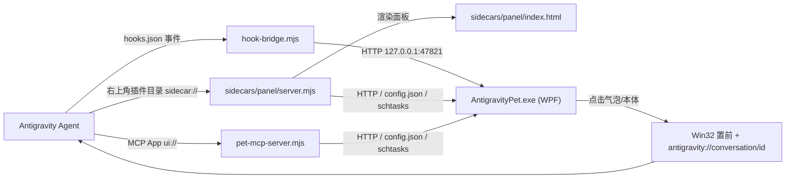

# 🐾 Antigravity Pet (Codex-Compatible Desktop Companion)

[English](#english) | [简体中文](#简体中文)

---

<a id="english"></a>

## English

A native Windows desktop companion plugin for **Google Antigravity**, built to match **OpenAI Codex Pets v2** specifications. Zero third-party runtime dependencies — powered by a lightweight C# WPF transparent overlay + Antigravity lifecycle hooks + built-in Auxiliary Pane Settings UI (`...` menu & MCP App).

### ✨ Key Features

- **Codex v2 Pixel Spritesheet Engine**
  - Fully supports **8×11 grid (`1536×2288 px`, `192×208 px` per cell)** `pet.json` + `spritesheet.png/webp` packs (and v1 `8×9` backward compatibility).
  - Scans both plugin `pets/` and `%USERPROFILE%\.codex\pets\` so community Codex pet packs work out of the box.
- **6 Built-in Pixel Characters (`36×39` crisp pixel-art style)**
  - `cyber-fox` (**CyberFox**, default) · `astro-bot` (**AstroBot**) · `shadow-cat` (**ShadowCat**) · `byte-ghost` (**ByteGhost**) · `shiba-dog` (**ShibaDog**) · `pixel-dragon` (**PixelDragon**)
- **Real-time Lifecycle Sync & Multi-Session Priority**
  - Automatically reflects agent status via `hooks.json`: `Needs Input > Blocked > Ready > Running > Idle`.
- **Click Bubble or Pet to Open Conversation**
  - Whether a task is **running** or **ready**, clicking the status bubble or pet brings Antigravity to the foreground (even if minimized or closed to tray) and navigates to that conversation via Win32 + `antigravity://conversation/<id>`.
- **EN / ZH Bilingual i18n (Follows Antigravity Language)**
  - Switch between **Auto (Follow Antigravity)**, **English**, and **简体中文** inside the settings panel or right-click menu.
- **Zero Taskbar / Tray Clutter**
  - Uses Win32 `WS_EX_TOOLWINDOW` with no taskbar button or system tray icon. Global toggle hotkey: **`Win + Alt + P`**.
- **Built-in Settings Panel (Top-Right `...` Aux Pane Menu)**
  - Enable/hide/quit pet, switch characters, adjust size (`0.75x / 1.0x / 1.3x / 1.5x`), bubble mode (`always / alerts / off`), launch & exit with Antigravity, idle roaming, 16-direction eye follow, always on top, sound alerts, and recent chat links.

### 🚀 Installation & Build (Windows 10 / 11)

1. Clone or copy this directory to `%USERPROFILE%\.gemini\config\plugins\antigravity-pet\`.
2. Run the one-click build script (uses built-in `.NET Framework 4.x` `csc.exe`, no extra SDK required):
   ```powershell
   cd "$env:USERPROFILE\.gemini\config\plugins\antigravity-pet"
   .\build.ps1 -Launch
   ```

---

<a id="简体中文"></a>

## 简体中文

专为 **Google Antigravity** 打造的原生 Windows 桌面宠物插件，完全对齐并兼容 **OpenAI Codex Pets v2** 规范。零第三方运行时依赖，由原生 C# WPF 透明悬浮窗 + Antigravity 生命周期 Hooks + 客户端右上角 `...` 插件面板构成。

### ✨ 核心特性

- **Codex v2 像素雪碧图引擎**：严格支持 `8×11` 网格（`1536×2288`，单格 `192×208`）`pet.json` + `spritesheet.png/webp`，同时扫描插件 `pets/` 与 `%USERPROFILE%\.codex\pets\`。
- **内置 6 款原创像素角色**：`cyber-fox`（小蓝狐）、`astro-bot`（像素宇航员）、`shadow-cat`（小黑猫）、`byte-ghost`（电子幽灵）、`shiba-dog`（像素柴犬）、`pixel-dragon`（像素小青龙）。
- **状态联动与点击直达对话**：严格按 `Needs Input > Blocked > Ready > Running > Idle` 仲裁；任务进行中或结束后点击气泡或桌宠，无论 Antigravity 最小化或关闭到托盘都能唤醒并打开对应对话。
- **内置多语言切换**：支持 **跟随 Antigravity 语言（自动）**、**English**、**简体中文**。
- **纯净悬浮**：采用 Win32 `WS_EX_TOOLWINDOW` 样式，绝不在 Windows 任务栏与系统托盘出现，全局显隐热键 **`Win + Alt + P`**。
- **客户端内全量设置面板**：在 Antigravity 右上角三个点（`...`）插件目录选择 **「桌面宠物设置」**，支持手动开关桌宠、换肤、尺寸调节、气泡模式、随 Antigravity 启停、待机散步、16 方向眼神跟随、提示音与状态预览。

### 🧩 架构概览



### 🌐 本地 HTTP API (`http://127.0.0.1:47821`)

| 接口 | 方法 | 说明 |
| :--- | :--- | :--- |
| `/health` | `GET` | 返回运行状态、多语言设置、全量配置、统计、最近会话与宠物列表 |
| `/state` | `POST` | 更新指定 `conversationId` 状态（`idle`/`running`/`needs_input`/`ready`/`blocked`） |
| `/skin` | `POST` | 切换宠物皮肤（`{"skin": "cyber-fox"}`） |
| `/reload` | `POST` | 热重载 `pets/` 与 `~/.codex/pets/` 宠物包列表 |
| `/control` | `POST` | 执行 `show`/`hide`/`toggle`/`open`/`quit`/`language`/`scale`/`bubbleMode`/`updateConfig` 等 |

### 📄 开源协议

[MIT License](LICENSE)
