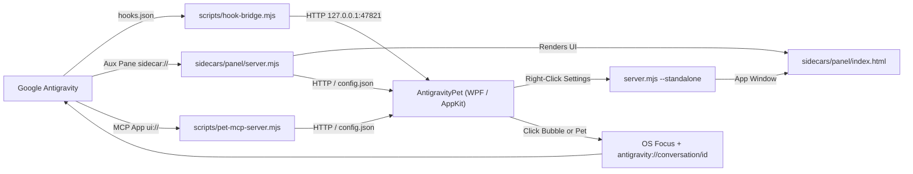

# Architecture, Hooks & Local API / 架构设计、Hooks 与本地接口

[English](#english) · [简体中文](#简体中文)

---

<a id="english"></a>

## English

This document covers the internal architecture, multi-session state arbitration, directory layout, and local HTTP control API for **Antigravity Pet** developers and contributors.

### 1. System Architecture



### 2. Project Structure

```text
antigravity-pet/
├── app/
│   ├── AntigravityPet.cs            # Windows native WPF overlay, HTTP server, DPI/touch & hotkey
│   ├── AntigravityPet.exe           # Prebuilt zero-dependency Windows executable
│   └── AntigravityPet.swift         # macOS native AppKit overlay, HTTP server & hotkey
├── assets/
│   ├── logo.svg                     # Plugin icon
│   └── preview.svg                  # Repository showcase banner
├── community/packs/                 # Built-in community pet pack fallback assets
├── docs/
│   └── DEVELOPMENT.md               # This developer guide
├── pets/                            # 8 built-in pixel-art character packs
├── scripts/
│   ├── generate-default-pets.ps1    # Procedural 36x39 pixel-art spritesheet generator
│   ├── hook-bridge.mjs              # Antigravity hooks -> HTTP bridge & background detector
│   ├── tool-label-mapper.mjs        # Live tool-call -> single-line natural label mapper
│   └── pet-mcp-server.mjs           # Cross-platform MCP server + MCP App UI provider
├── sidecars/panel/
│   ├── sidecar.json                 # Aux Pane integration manifest (... menu)
│   ├── server.mjs                   # Cross-platform Sidecar & standalone HTTP server
│   └── index.html                   # 11-locale 5-tab modern settings panel UI
├── skills/
│   ├── pet/SKILL.md                 # Skill guide for controlling the desktop pet
│   └── hatch-pet/SKILL.md           # Skill guide for hatching custom pixel pets
├── ui/settings.html                 # MCP App 5-tab settings UI (synced with panel)
├── build.ps1                        # Windows one-click builder & launcher
├── build.sh                         # macOS one-click Swift compiler & .app packager
├── CHANGELOG.md                     # SemVer changelog
├── community-pets.json              # Community pet catalog manifest
├── CUSTOM_PET_SPEC.md               # v1-v3 & single-image custom pet specification
├── hooks.json                       # Antigravity hook bindings
├── mcp_config.json                  # MCP server configuration
├── plugin.json                      # Antigravity plugin manifest
└── README.md
```

### 3. Multi-Session Priority & Status Machine (v4.5+)

When multiple Antigravity conversations or background subagents run concurrently, the pet arbitrates its display state strictly by priority:

| Priority | State | Trigger (`hooks.json`) | Visual & Bubble Feedback |
| :---: | :--- | :--- | :--- |
| **1** | `Needs Input` | User confirmation / question required | Amber halo + `!` badge + prompt bubble + optional chime |
| **2** | `Blocked` | Tool error or execution failure | Red halo + `✕` badge + error bubble (click to inspect) |
| **3** | `Running` | Foreground thinking, edits, commands (`PreToolUse` / `PostToolUse`) | `#0EA5E9` cyan halo + busy animation + live single-line tool bubble |
| **4** | `BackgroundRunning` | Foreground idle while background tasks/subagents run | `#818CF8` lavender halo + `🌙` badge + floating moon + stacked task switcher |
| **5** | `Ready` / `Idle` | Task finished (`Stop`) / no active tasks | Green celebration / procedural breathing + tiered boredom + eye follow |

- **Live Tool-Call Bubble**: `PreToolUse` (`matcher: "*"`) passes non-destructive tools immediately with `{"decision":"allow"}` and formats short single-line labels via `scripts/tool-label-mapper.mjs` (350ms anti-flicker debounce, immediate clear on `PostToolUse`, 1.2s gap fallback to `Thinking`). High-risk `run_command` calls route to `/approval` for interactive bubble confirmation.

### 4. Local HTTP Control API (`http://127.0.0.1:47821`)

| Endpoint | Method | Description | Example Payload |
| :--- | :---: | :--- | :--- |
| `/health` | `GET` | Returns running status, effective locale, full config, stats, recent chats, and pet list | — |
| `/state` | `POST` | Updates conversation state (`idle` / `running` / `background_running` / `needs_input` / `ready` / `blocked`) | `{"conversationId":"abc","state":"running","message":"Thinking"}` |
| `/approval` | `POST` | Synchronous `PreToolUse` command approval (requires `X-Pet-Token` from `~/.antigravity-pet/http-bridge.json`) | `{"conversationId":"abc","command":"rm -rf ..."}` |
| `/skin` | `POST` | Switches the active character pack | `{"skin":"cyber-fox"}` |
| `/reload` | `POST` | Hot-reloads pet packs from `pets/` and `~/.antigravity-pet/pets/` | `{}` |
| `/control` | `POST` | Executes window & config actions (`show`/`hide`/`toggle`/`open`/`quit`/`language`/`scale`/`bubbleMode`/`updateConfig`/`dockLeft`/`dockRight`) | `{"action":"language","value":"en"}` |

---

<a id="简体中文"></a>

## 简体中文

本文档面向 **Antigravity Pet** 开发者与贡献者，说明内部架构、多会话状态仲裁机制、项目目录结构与本地 HTTP 控制接口。

### 1. 系统架构与数据流

见上方 Mermaid 架构图：`Google Antigravity` 通过 `hooks.json` 触发 `scripts/hook-bridge.mjs` 上报状态与工具事件；设置界面通过 `sidecars/panel/server.mjs`（Sidecar 与独立 `--standalone` 窗口）及 `scripts/pet-mcp-server.mjs`（MCP App）与桌面端进程 `127.0.0.1:47821` 通信；点击气泡或本体通过 Deep Link 拉起对应 Antigravity 对话。

### 2. 多会话优先级仲裁（v4.5+）

当多个前台对话与后台子任务并行时，桌宠严格按照以下优先级展示最高优先级状态：

| 优先级 | 状态 | 触发场景 (`hooks.json`) | 桌宠表现与交互 |
| :---: | :--- | :--- | :--- |
| **1** | `Needs Input` | Agent 需要用户审批或回答问题 | 琥珀色光环 + `!` 徽章 + 审批/提示气泡 |
| **2** | `Blocked` | 工具调用报错或执行阻断 | 红色光环 + `✕` 徽章 + 报错气泡，点击直达排查 |
| **3** | `Running` | 前台思考、读写文件、执行命令 | `#0EA5E9` 冰蓝光环 + 工作动画 + 实时单行工具动作气泡 |
| **4** | `BackgroundRunning` | 前台空闲且存在活跃后台任务/子代理 | `#818CF8` 柔和蓝紫光环 + `🌙` 角标 + 飘浮月亮 + 可展开多后台切换列表 |
| **5** | `Ready` / `Idle` | 任务完成 (`Stop`) / 全部空闲 | 绿色庆祝 / 程序化呼吸 + 三阶无聊待机 + 16 方向眼神跟随 |

- **实时工具气泡**：`hooks.json` 的 `PreToolUse`（`matcher: "*"`）对常规工具返回 `{"decision":"allow"}` 放行，并由 `scripts/tool-label-mapper.mjs` 将工具参数映射为无省略号单行短文案（350ms 防抖、`PostToolUse` 立即清除、1.2s 空档回退 `正在思考`）；高危 `run_command` 走 `/approval` 同步气泡审批。

### 3. 本地 HTTP 控制接口 (`http://127.0.0.1:47821`)

| 接口 | 方法 | 说明 |
| :--- | :---: | :--- |
| `/health` | `GET` | 返回运行状态、当前生效语言、全量配置、统计数据、最近会话列表与宠物列表 |
| `/state` | `POST` | 更新指定 `conversationId` 的状态（支持 `isBackground`、`backgroundDone`、`backgroundSuccess` 等字段） |
| `/approval` | `POST` | `PreToolUse` 同步命令审批（需携带 `~/.antigravity-pet/http-bridge.json` 中的 128-bit `X-Pet-Token`） |
| `/skin` | `POST` | 切换宠物角色皮肤（如 `{"skin": "cyber-fox"}`） |
| `/reload` | `POST` | 热重载 `pets/` 与 `~/.antigravity-pet/pets/` 宠物包 |
| `/control` | `POST` | 执行窗口与配置控制（`show`/`hide`/`toggle`/`open`/`quit`/`language`/`scale`/`bubbleMode`/`updateConfig`/`dockLeft`/`dockRight`） |
